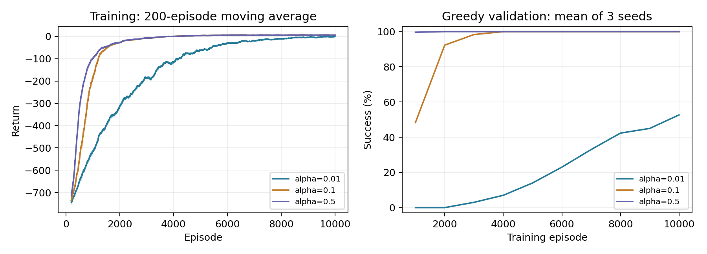

# Taxi-v3 Q-learning - Topics in AI

A from-scratch tabular Q-learning agent for passenger pickup and delivery using Farama Gymnasium. Prepared for Topics in AI, Assignment 1, COMSATS University Islamabad, Attock Campus.

## Included deliverables

| File | Purpose |
| --- | --- |
| `main.py` | Full hyperparameter experiment or saved-agent evaluation |
| `agent.py` | NumPy Q-table, epsilon-greedy action selection and learning update |
| `utils.py` | Training, testing, charts and GIF generation |
| `requirements.txt` | Dependencies; Gymnasium pinned to 1.2.3 for Taxi-v3 |
| `taxi_q_learning.ipynb` | Executed notebook with actual outputs and visualizations |
| `results/q_table.npy` | Trained 500 x 6 Q-table |
| `results/trained_agent.gif` | Successful policy demonstration |
| `results/learning_curves.png` | Learning-rate comparison |
| `results/summary.json` | Measured validation and test metrics |
| `results/training_history.json` | Per-episode returns and validation checkpoints |
| `technical_report.pdf` | Technical report within the four-page limit |
| `START_HERE.md` | Windows, VS Code, GitHub Desktop and viva guide |

## Run

Python 3.11 or 3.12 is recommended; execution was verified with Python 3.12.

```bash
python -m pip install -r requirements.txt
python main.py --evaluate
```

Run all nine training sessions and regenerate model, plots and GIF:

```bash
python main.py
```

Open the notebook in Jupyter or VS Code and Run All to regenerate notebook outputs as well. The notebook calls the full experiment and does not require a separate main.py run. On Windows, see START_HERE.md for exact virtual-environment commands. The report is a static snapshot of the included experiment and is not overwritten by training.

## Experimental design

- Environment: Taxi-v3, 200-step episode limit, no action masks.
- Learning rates: 0.01, 0.1, 0.5; training seeds: 42, 43, 44.
- Each run: 10,000 episodes; gamma=0.99; epsilon=max(0.05, 0.9995**episode).
- Validation: 100 greedy episodes every 1,000 training episodes.
- Selection: highest mean early validation return across checkpoints 1,000, 2,000 and 3,000 and across all three seeds. Save seed 42 for the selected learning rate.
- Final comparison: greedy agent versus uniformly random actions over the same 300 final reset seeds.
- Q targets bootstrap across truncation but not true termination.
- All metrics are actual execution results. The included notebook cells were executed sequentially through in-process IPython because the preparation host does not allow Jupyter kernel sockets. It remains a standard notebook runnable through Jupyter/VS Code.

## Learning curves



## Trained policy


## References

- [Farama Gymnasium Taxi documentation, version 1.2.3](https://gymnasium.farama.org/v1.2.3/environments/toy_text/taxi/)
- Sutton and Barto, *Reinforcement Learning: An Introduction*, second edition, Chapter 6.

The simulator is a small deterministic benchmark; results do not establish real-world driving performance or transfer to new maps.
